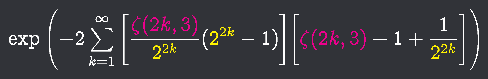

# kepler-bouwkamp

calculate [Kepler-Bouwkamp constant](https://en.wikipedia.org/wiki/Kepler%E2%80%93Bouwkamp_constant) ([0.114942044853...](https://oeis.org/A085365
)) to **100,000** digits for [daamath](https://deftasparagusanaconda.github.io/daamath/), using [FLINT](https://flintlib.org/)'s [Hurwitz ζ](https://en.wikipedia.org/wiki/Hurwitz_zeta_function) function



[kepler_bouwkamp_1k.txt](https://raw.githubusercontent.com/deftasparagusanaconda/kepler-bouwkamp/main/kepler_bouwkamp_1k.txt)  
[kepler_bouwkamp_10k.txt](https://raw.githubusercontent.com/deftasparagusanaconda/kepler-bouwkamp/main/kepler_bouwkamp_10k.txt)  
[kepler_bouwkamp_100k.txt](https://raw.githubusercontent.com/deftasparagusanaconda/kepler-bouwkamp/main/kepler_bouwkamp_100k.txt)

# pseudocode

```python
from flint import arb, ctx
from math import ceil, log10

ctx.dps = 100100
last_k = ceil(ctx.dps / log10(9 / 4)) # 284228 for 100100 dps

acc = 0
for k in range(2, term_count * 2, 2):
	p = arb(2) ** k
	z = arb(k).zeta(3)
	acc += ((z/k) * (p-1)) * ((z+1) + (1/p))

result = (-2 * acc).exp()

print(result)
```
